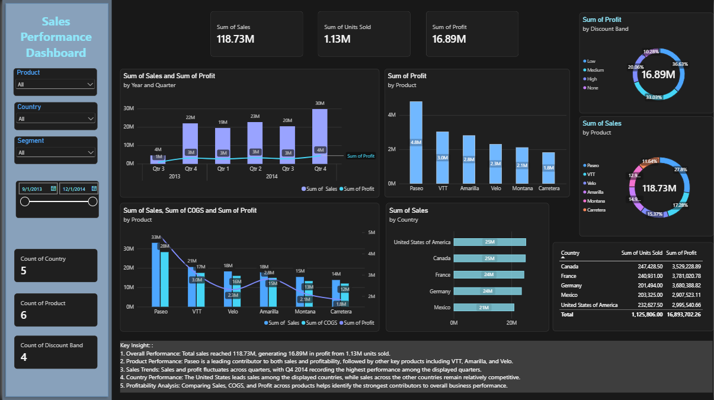

# Sales Performance Dashboard

A Power BI dashboard analyzing sales, profit, and units sold across 6 products and 5 countries, with interactive filters for product, country, segment, and date.

## Highlights

- **118.73M** total sales and **16.89M** total profit (about 14.2% margin)
- **1.13M** units sold
- **Paseo** is the top product: 4.8M profit and about 28% of total sales
- **Q4 2014** is the strongest quarter, with about 30M in sales

## Key Findings

- The United States and Canada tie for top sales (25M each), but the US earns less profit (3.0M) than France (3.8M), Germany (3.7M), and Canada (3.5M).
- Profit is concentrated in a few products: Paseo, VTT, and Amarilla lead.
- Sales and profit fluctuate by quarter, peaking at the end of 2014.

## Tools

Power BI · Data Modeling · Data Visualization · Interactive Filters

## Files

- `Sales_Performance_Dashboard.pbix`: the Power BI report (open in Power BI Desktop)

**Lara Kashmeri** · [Portfolio](https://larakashmeri.github.io/) · [LinkedIn](https://www.linkedin.com/in/lara-kashmeri-158951244)
